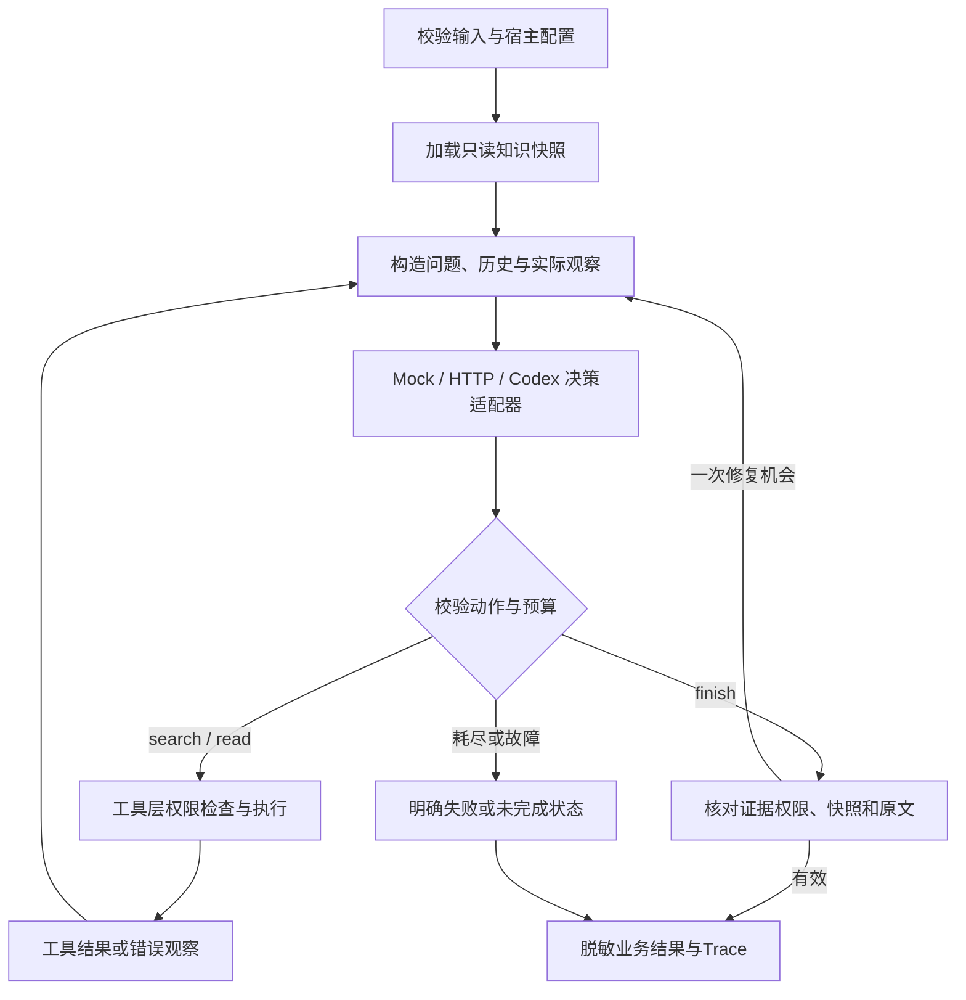

# 方案与技术取舍

原生 Python 决策循环，运行与离线测试没有第三方依赖。模型仅返回一个结构化动作；业务工具执行、权限、版本与证据校验全部由项目负责。

我负责总体方案、工程取舍及人工检查，AI负责将方案落实为代码，并提供部分实现建议。这里的“工具”就是项目提供的本地查询函数；“决策循环”就是模型先选一步、看执行结果，再决定下一步。

## 模块边界

| 模块 | 职责 |
| --- | --- |
| protocol / schemas | 严格协议、重复JSON键及未知字段拒绝 |
| knowledge | 资料校验、不可变快照、权限预过滤、本地检索 |
| tools | 受控ID读取、证据表、引用组装与再次授权 |
| agent / config | 模型—工具—观察循环、预算、修复、状态 |
| providers | 决策适配，供应商响应不直接进入公开Trace |
| safeio | UTF-8、大小限制、无覆盖原子保存、脱敏导出 |
| evaluate | 预期隔离、逐场景实际输出与报告 |

## 动态决策与模拟边界

真实后端每次看到实际观察后选择补查、读取或结束；运行时不按场景标签分支产生业务答案。工具失败不会被工具内部隐藏重试。

Mock是确定性规则模拟，包含领域词替换、数值冲突处理和显式攻击样本来源标记过滤。它验证协议和工程流程，不证明模型理解、冲突推理或提示注入防护效果；全部输出标记is_mock。

HTTP支持Chat Completions的messages、严格json_schema与非流式文本响应子集；密钥来自环境，拒绝重定向。可终止的HTTP工作进程使DNS、连接和读取均受父进程deadline约束。

Codex在独立最小目录执行，不复制认证资料，忽略用户配置避免私有连接器；关闭命令、应用、插件、浏览器、hooks、多Agent等能力，额外检查事件流。发现非预期工具执行则调用无效。原始事件不进入提交记录。实际兼容性及阻塞见评估。

## 证据、权限与版本

每次请求固定使用一版资料，称为“知识快照”，避免查到旧版本却引用新版本。资料对象冻结，索引只在内存；更新由下一请求重新加载，无磁盘索引失效问题。内容哈希相当于资料指纹，用来检查内容是否改变，不证明资料权威。

检索在排序、摘要和关联来源提示前过滤权限；读取再次校验。可信操作者配置groups，输入、模型和资料不能覆盖；本机操作者仍能编辑文件，所以这不是SSO或敌对租户隔离。

证据ID包含请求随机值、快照、访问范围、资料哈希和片段ID。finish只能引用本次读到的证据，运行时组装原文并再次核对。claims关联关键结论；原文一致仍不等于语义支持，需独立复核。

版本日期不代表优先级；只有资料明确提供的适用范围、生效时段和替代关系才可消解冲突。文档和历史均不能授予工具权限。

## 检索与执行取舍

增强检索采用中文字符二元组、有限同义表达、标题加权与文档级去重；返回同主题可见来源，降低重复片段挤掉冲突资料的风险。基线为完整查询子串匹配，比较只说明相对该弱基线的收益，不能推导优于BM25或向量检索。

不引入向量库、答案缓存、长期记忆或服务平台。历史超限明确拒绝，不自动摘要；多子问题的语义完整性依赖评估。

默认10次决策、8次工具、20次模型请求、300秒整次任务、90秒单次调用、60000上下文字符。传输最多重试一次并消耗请求预算；过长Retry-After明确结束，不提前重试。连续两次协议错误、三次相同动作/观察分别停止为model_error与incomplete。

详细取舍见 [开发计划第8—12节](../DEVELOPMENT_PLAN.md)。
